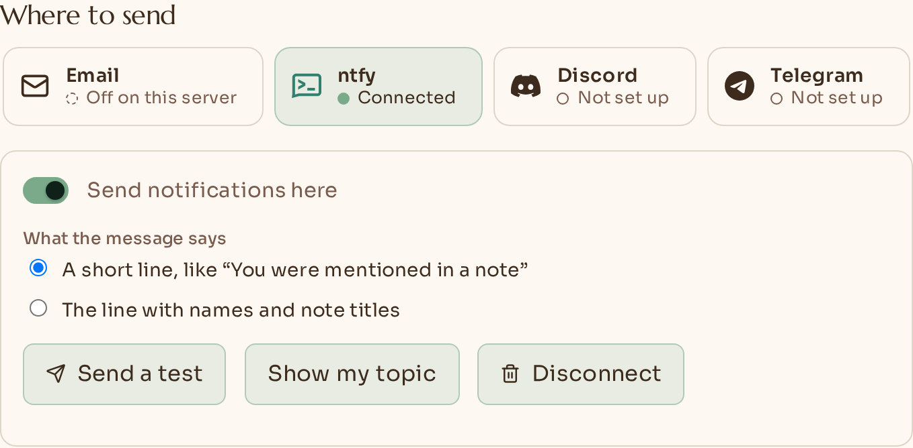
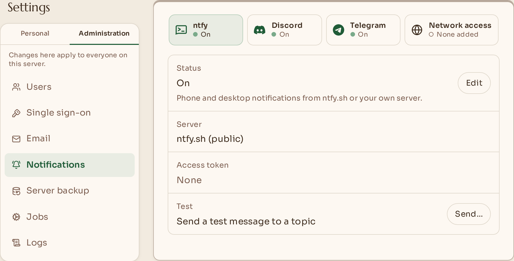

  

<h2 align="center">Papyra 1.3 — notifications where you already are</h2>

  Notifications through ntfy, Discord and Telegram, settings that say who they affect, and no more counting of installs.

  <picture>
    <source media="(prefers-color-scheme: dark)" srcset="https://raw.githubusercontent.com/lyfie-org/papyra/v1.3.0/.github/release-notes/media/v1.3.0/tiles-dark.png">
    
  </picture>

### ⚠️ Before you upgrade
- **Saved secrets are now encrypted.** The mail password, single sign-on secrets, Git tokens and the new chat tokens are stored encrypted on your server. Anything you saved before is converted the first time 1.3 starts, with nothing to do. The catch is going back: an older version cannot read them, so if you roll back to 1.2 or earlier you will need to type them in again. Keep `.papyra/keys` with your backups; without it Papyra treats a saved secret as not set and asks you to enter it again.
- **Older versions stop showing the update notice.** Papyra 1.1 and 1.2 (1.0 had no update check) look for updates at an address of mine, which I am switching off after this release. They fail quietly and say nothing, so upgrade by hand and they are back on track. From 1.3 the check asks GitHub instead ([details](https://papyra.app/docs/update-check)).
- **Settings pages have new names.** Your data, Git backup, Notifications (the server's side, under Administration), Server backup and Single sign-on (full list below). Bookmarks and links you have shared keep working.

### 🌟 Highlights
- **Notifications beyond email.** Papyra can now tell you about a mention, a share, a comment or a backup that needs attention through **ntfy** (a push to your phone or desktop), a **Discord** message or **Telegram**. An administrator switches each service on once, and then each person connects their own place to send to. Nothing is on until it is switched on, and nothing is sent to a place until you have said it is yours. By default a message is one generic line, like "You were mentioned in a note", with no names, no titles and no note text. [How it works](https://papyra.app/docs/notifications)
- **Settings that say who they affect.** Administrators now see **Personal** and **Administration** as two separate areas, as tabs at the top of Settings, so a switch is never a guess between "just me" and "everyone on this server". The server's Notifications page is a row of tiles, one per service, each saying where it stands. Everyone else sees no switch and nothing new.

### 🚀 Features
- **ntfy.** Papyra makes you a long random topic (or you type your own). Subscribe to it in the ntfy app, send a test, and say it arrived. Use the public ntfy.sh or your own server.
- **Discord, two ways.** A **direct message** from a bot, which only you can see: give Papyra your Discord user ID and type back the code the bot sends you (it works once, for 10 minutes). Or a **channel webhook**, which everyone who can read that channel can read, so Papyra says so and suggests a private one. The administrator chooses which of the two people may use.
- **Telegram.** Choose **Get a link**, open it and press **Start**. The page notices by itself. Send `/stop` to the bot at any time to disconnect. Papyra asks Telegram for the bot's messages, so no public address is needed.
- **A switch for each place.** *What Papyra tells you about* gets a column for every place you have confirmed, beside email, so a mention can go to ntfy while backup news stays in your inbox. The always-on notices (a new sign-in, a changed password) stay email only.
- **Names and titles are your choice.** On each connected place, *What the message says* can be switched from the short line to the line with names and note titles. Note text is never sent, either way.
- **When a place stops working.** Papyra tries again after 1 minute, 5 minutes, 30 minutes, 2 hours and 6 hours, then gives up on that message. If the service refuses outright, or five messages in a row are given up on, the place is paused. You get one email saying so, and **Turn back on** is in Settings.
- **Network access (administrators).** Papyra connects only to public internet addresses. If your ntfy runs at home, list it under *Administration → Notifications → Network access*. The server itself, link-local addresses and cloud metadata addresses can never be reached, even if listed.
- **Tooltips that belong.** One tooltip for the whole app in Papyra's own look, with the shortcut shown as keys (for example *Bold* with <kbd>Ctrl</kbd> <kbd>B</kbd>). It opens on hover and on keyboard focus, stays while you read it, and Esc closes it.
- **Ready for translations.** Every sentence in the screens touched by this release lives in a message file rather than in the code, so a language can be added later as one file. Only English ships today; email and server messages are English for now.

### 🧭 Quick tour

**Get a notification on your phone (ntfy)**
1. Go to **Settings → Notifications**, open the **ntfy** tile and choose **Set up**, then **Continue**.
2. In the ntfy app, subscribe to the topic Papyra shows. The topic is the only thing keeping your notifications private, so keep the long one it suggests.
3. Choose **Send a test**. When it arrives, choose **Yes, it arrived**.

**Turn it on for your server (administrators)**
1. Open the **Administration** tab at the top of Settings, then **Notifications**.
2. Pick a tile and choose **Edit**. For ntfy, turn it on. For Discord, turn it on and paste the bot token if you want direct messages. For Telegram, paste the token [BotFather](https://t.me/BotFather) gives you. Papyra checks the Discord and Telegram tokens with the service when you save.
3. People can now connect their own place from **Settings → Notifications**.

  <picture>
    <source media="(prefers-color-scheme: dark)" srcset="https://raw.githubusercontent.com/lyfie-org/papyra/v1.3.0/.github/release-notes/media/v1.3.0/server-settings-dark.png">
    
  </picture>

### ✨ Improvements
- **Pages with clearer names.** Data & Storage is now **Your data**, Backup is **Git backup**, Instance backup is **Server backup**, Chat notifications is **Notifications** under Administration, SSO is **Single sign-on**, and the download in Your data is **Backup file**. Messages, emails and the docs use the same names, and settings search finds a page by its old name too.
- **Search tells you which area.** A settings result now reads, for example, *Administration › Email › Mail server (SMTP)*.
- **Plainer words in Settings.** Lines that explained how something is stored now say what it means for you, and the vault is described the same way everywhere: you set a **Vault PIN**, you **open** the vault, and it **closes** itself after a few idle minutes.
- **The update popup says what it does.** *Papyra looks at GitHub once a day. Nothing about your server is sent.*
- **A clearer "can't reach the server".** The pages that load your notes now say to check your connection and try again.
- **Calmer on a phone.** The settings pills and the service tiles scroll sideways and respect reduced motion. When the tiles don't fit, on any screen, a small arrow on the row shows there are more and moves to them, so no trackpad or sideways wheel is needed.

### 🐛 Fixes
- **Git backup no longer says locked notes are plain text.** In a readable Git backup, locked notes stay encrypted, as they are on your server; in an encrypted backup everything is sealed. Only the words on the screens, the setup guide and the docs said otherwise. Nothing about your backups changes.
- **Pasted markdown is formatted, as if you had typed it.** Pasting `## Title`, a list, a quote, a table, a code fence or `**bold**` used to leave the characters as they were, and a line starting with `#` was even turned into a link to itself. Now a heading is a heading, a list is a list, and each pasted block starts on its own line, whether it lands at the end of a paragraph, in the middle or at the start. It also works when you copy from a code editor or a terminal. Ordinary text, a lone web address (still becomes a link), text that already carries its own formatting (from a web page or Word), files and pictures are pasted exactly as before, and nothing is converted inside a code block or a table cell.

### 🔒 Privacy and security
- **Papyra makes no request to a server I run.** The daily update check is one plain request to GitHub for the latest release. It carries no ID, no version number, no processor or system, and nothing about your notes, accounts or settings, and I no longer keep a count of installs. The install counter, its database and its public statistics page are retired, and every mention of them is gone from the site and the docs. GitHub sees the address your server connects from, like any web request. `PAPYRA_UPDATE_CHECK_ENABLED=false` still turns it off. [What it asks](https://papyra.app/docs/update-check)
- **Secrets are encrypted at rest.** The mail password, single sign-on secrets, Git tokens, bot tokens, the ntfy token and every webhook address.
- **Chat messages say as little as possible.** One generic line by default; titles only if the person turns them on; never anything from a locked note.
- **Outbound connections are checked when they are made.** Public addresses only unless an administrator lists a server, and redirects are not followed.

### 🧰 Self-hosting
- **New optional settings** you can put in your compose file instead of using the screens. They are read once, on the first start, and only if nobody has chosen anything in the app yet: `PAPYRA_NTFY_URL`, `PAPYRA_NTFY_TOKEN` and `PAPYRA_TELEGRAM_BOT_TOKEN`. Anything that does not check out is skipped with a line in the log. Discord has nothing to import. [Configuration](https://papyra.app/docs/configuration)
- **Telegram needs no public address.** A bot can have only one reader, so if something else (a webhook, a second Papyra) uses the same bot, Settings says so.
- **The database upgrades itself.** New tables hold the places to send to, the one-time codes and the queue of messages. There is nothing to run and no new volume.
- A leftover `.papyra/instance-id` file from older versions is deleted on start. Nothing used it any more.

**Upgrade:** `docker compose pull && docker compose up -d` · **Full changelog:** [v1.2.0...v1.3.0](https://github.com/lyfie-org/papyra/compare/v1.2.0...v1.3.0)
