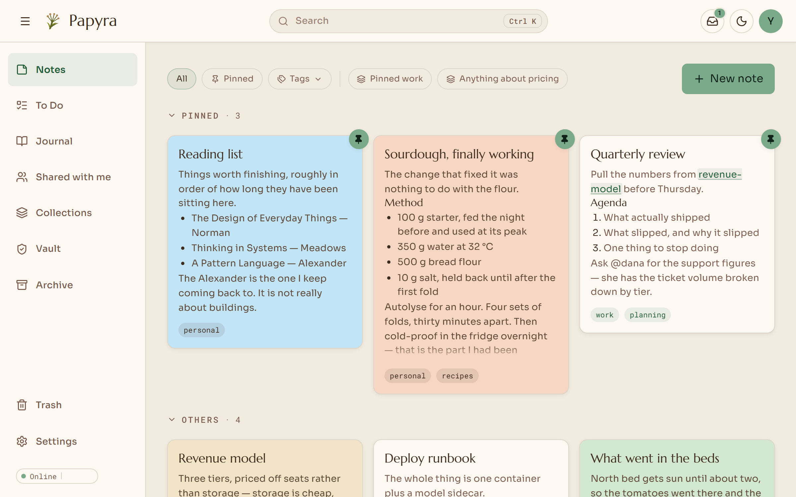
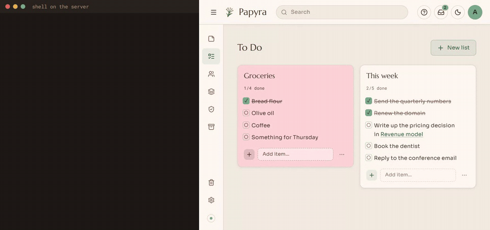
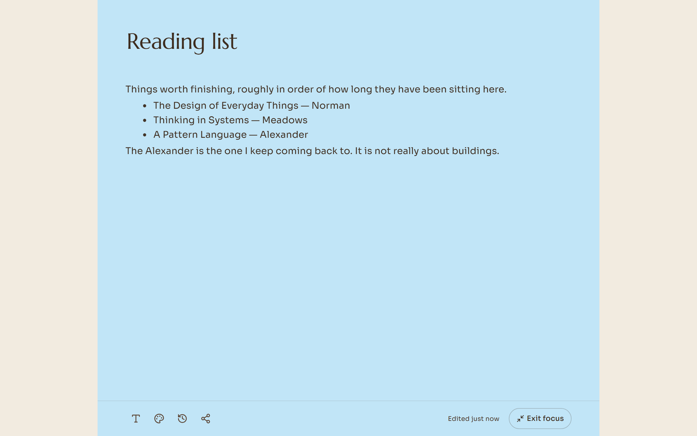
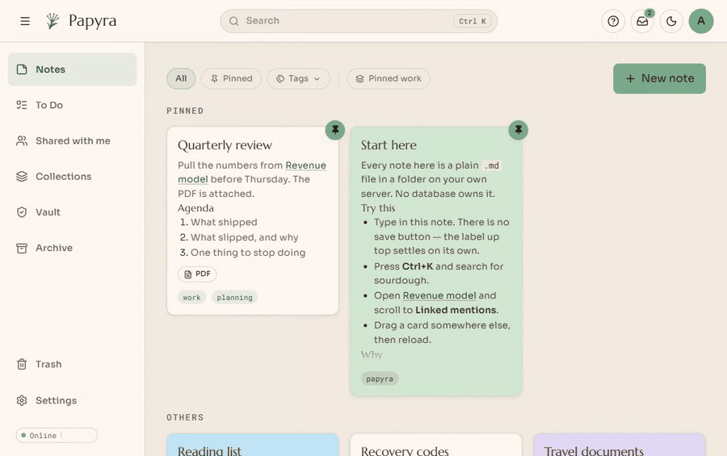
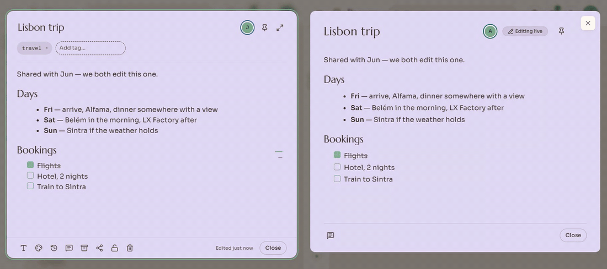
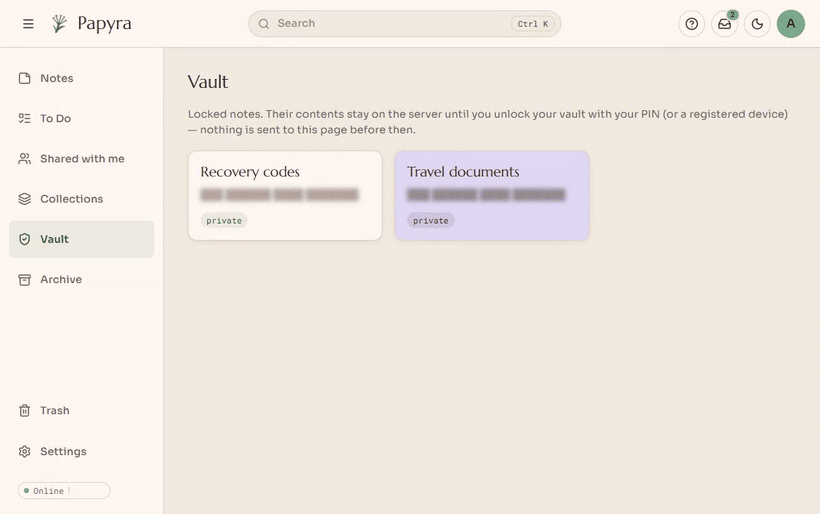
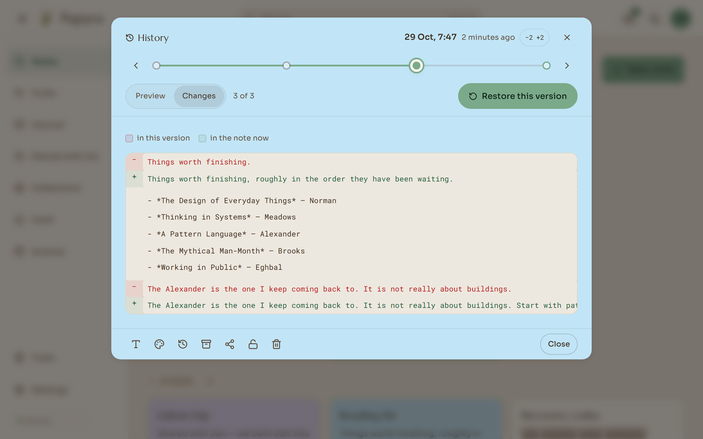
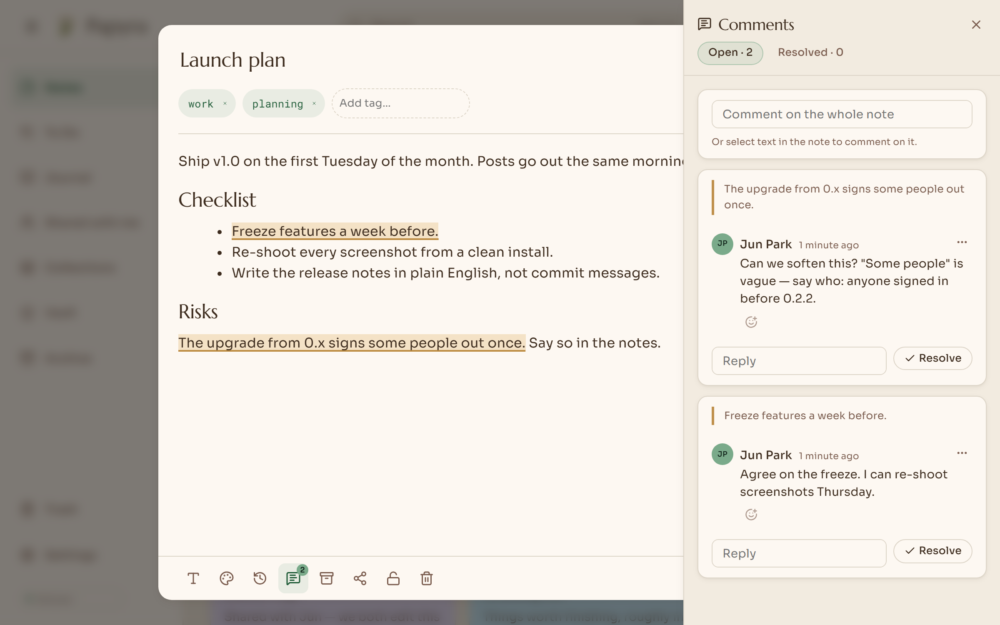
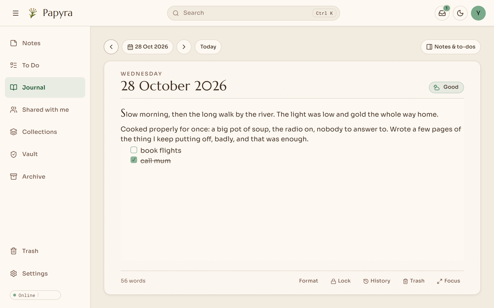
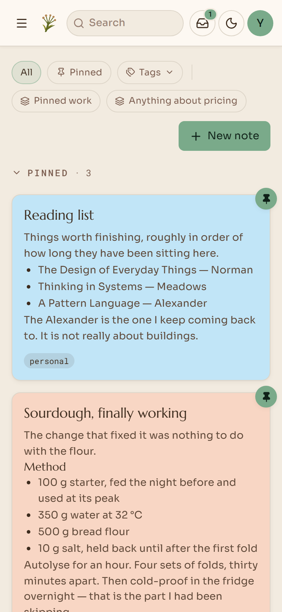

<div align="center">
  
  <h1>Papyra</h1>
  <p><strong>A calm, self-hosted home for your notes.</strong><br/>
  Google Keep–style notes on your own server, where every note is a plain Markdown file.</p>

  <p>
    <a href="https://github.com/lyfie-org/papyra/releases"></a>
    <a href="https://hub.docker.com/r/lyfie/papyra"></a>
    <a href="LICENSE"></a>
    <a href="https://discord.gg/KQNsjGAUUz"></a>
  </p>

  <p>
    <a href="https://papyra.app/demo"><strong>Demo</strong></a> ·
    <a href="https://papyra.app">Website</a> ·
    <a href="https://papyra.app/docs">Docs</a> ·
    <a href="https://discord.gg/KQNsjGAUUz">Discord</a>
  </p>
</div>

<br/>

<picture>
  <source media="(prefers-color-scheme: dark)" srcset="papyra.app/src/assets/shots/desk-desktop-dark.png" />
  
</picture>

> [!NOTE]
> **Papyra 1.0** — the first stable release. The file format, data layout and upgrade
> path are stable from here on. Still: back up your data volume, hidden `.papyra` folders included.

## ✨ Why Papyra

- **Your notes are just files.** Every note is a `.md` file with a small YAML header, in a folder you own. If you ever stop using Papyra, you still have a normal folder of Markdown.
- **One container, one volume.** No database server, no search server, no sidecars. amd64 and arm64, so a Raspberry Pi 4 or 5 is plenty.
- **Plays well with your other tools.** Obsidian, VS Code, `grep`, Syncthing and git can all work on the same folder. Papyra notices outside changes and catches up live.
- **Private by default.** No tracking, analytics or crash reports, and your notes stay on your server. The only call home is a daily check for updates, and I use it as a count of active installs to keep myself motivated. GPLv3.

<p align="center">
  
  <br/><sub>Edit the file from anywhere: the app catches up on its own.</sub>
</p>

## 🚀 Install in two commands

You need Docker with Compose.

```bash
curl -O https://raw.githubusercontent.com/lyfie-org/papyra/main/docker-compose.hub.yml
docker compose -f docker-compose.hub.yml up -d
```

Open **http://localhost:8080** and create the first account. That's it.

<details>
<summary><b>Running it on a server or NAS?</b> A few things worth knowing</summary>

<br/>

- **HTTPS / reverse proxy:** put Papyra behind Caddy, Traefik, Nginx Proxy Manager or a Cloudflare Tunnel. See [HTTPS](https://papyra.app/docs/https/).
- **Opening it by IP over plain http** (e.g. `http://192.168.1.50:8080` or a Tailscale IP)? Set `PAPYRA_ALLOW_INSECURE_COOKIES: "true"` in the compose file, or the browser won't keep you signed in. Only do this on a network you trust.
- **File ownership:** `PUID` / `PGID` in the compose file decide who owns the files in the volume, so you can edit them over SMB or Syncthing.
- **Want the notes in a folder you can see?** Swap the named volume for a bind mount, e.g. `./papyra-data:/data`. See [Your files](https://papyra.app/docs/files/).
- **Updating:** `docker compose -f docker-compose.hub.yml pull && docker compose -f docker-compose.hub.yml up -d`.
- **Every setting:** [Configuration](https://papyra.app/docs/configuration/).

</details>

## 🗒️ What you get

<table>
  <tr>
    <td width="50%" valign="top">
      <h3>✍️ Write without a save button</h3>
      Click a card and type. It saves when you pause, works offline, and syncs when you're back.
      <br/><br/>
      <picture>
        <source media="(prefers-color-scheme: dark)" srcset="papyra.app/src/assets/shots/focus-desktop-dark.png" />
        
      </picture>
    </td>
    <td width="50%" valign="top">
      <h3>🔎 Find anything, fast</h3>
      Press <kbd>Ctrl</kbd> + <kbd>K</kbd>. Full-text search across titles, text and tags, with highlighted matches.
      <br/><br/>
      
    </td>
  </tr>
  <tr>
    <td width="50%" valign="top">
      <h3>👥 Edit together, live</h3>
      Share a note and type in it at the same time, with named cursors. It's still a <code>.md</code> file on disk.
      <br/><br/>
      
    </td>
    <td width="50%" valign="top">
      <h3>🔒 A vault for private notes</h3>
      Locked notes are blurred everywhere, open with a PIN or your fingerprint, and are encrypted on disk.
      <br/><br/>
      
    </td>
  </tr>
  <tr>
    <td width="50%" valign="top">
      <h3>🕰️ Go back in time</h3>
      Every note keeps its history. Step through versions, see what changed, restore one.
      <br/><br/>
      <picture>
        <source media="(prefers-color-scheme: dark)" srcset="papyra.app/src/assets/shots/history-desktop-dark.png" />
        
      </picture>
    </td>
    <td width="50%" valign="top">
      <h3>💬 Comment and link</h3>
      Select text to comment. Type <code>[[</code> to link notes; every note lists what links to it.
      <br/><br/>
      <picture>
        <source media="(prefers-color-scheme: dark)" srcset="papyra.app/src/assets/shots/comments-desktop-dark.png" />
        
      </picture>
    </td>
  </tr>
</table>

<p align="center">
  <picture>
    <source media="(prefers-color-scheme: dark)" srcset="papyra.app/src/assets/shots/journal-desktop-dark.png" />
    
  </picture>
  <br/><sub><b>📔 A journal, too.</b> A page for each day, with moods, a calendar, voice notes and days you can lock. Still plain Markdown files, and it exports as files or a PDF book.</sub>
</p>

**Also in the box:** pictures and PDFs inside notes · to-do lists · tags and smart collections · sharing with people or by link (with expiry) · passkeys, an authenticator app and single sign-on (OIDC) · import from Obsidian, Google Keep and Day One · export everything to a zip · sealed backups · backup to a private GitHub repo · installs as an app on your phone.

<p align="center">
  <picture>
    <source media="(prefers-color-scheme: dark)" srcset="papyra.app/src/assets/shots/desk-mobile-dark.png" />
    
  </picture>
</p>

## 👣 Your first ten minutes

1. **Create your account.** A short setup walks you through a username, an authenticator app, email, a password and a vault PIN. (Restoring a backup instead? That's an option on the first screen.)
2. **Bring your notes.** *Settings → Data & Storage* imports an Obsidian vault (.zip), a Google Keep Takeout, or a Day One journal. ([Importing](https://papyra.app/docs/importing/))
3. **Write.** Click **New note**, or press <kbd>/</kbd> in a note for headings, lists, tables, images and embeds. ([Writing](https://papyra.app/docs/writing/))
4. **Lock what's private.** Lock any note with the vault PIN from setup; add your fingerprint or face in *Settings → Security*.
5. **Put it on your phone.** Open Papyra in your phone's browser and choose *Add to Home Screen*.
6. **Back it up.** *Settings → Data & Storage* downloads a sealed backup; *Settings → Backup* can push to a private GitHub repo. ([Backups](https://papyra.app/docs/backups/))

Stuck? Check [Troubleshooting](https://papyra.app/docs/troubleshooting/) or ask in [**#papyra-help on Discord**](https://discord.gg/KQNsjGAUUz).

## 💬 Community

- **Discord:** [discord.gg/KQNsjGAUUz](https://discord.gg/KQNsjGAUUz). Help, ideas, release news, and the people building it.
- **Bugs and feature requests:** [GitHub Issues](https://github.com/lyfie-org/papyra/issues).
- **Security issues:** please report privately via [GitHub security advisories](https://github.com/lyfie-org/papyra/security/advisories/new).
- **Want to help?** See [CONTRIBUTING.md](CONTRIBUTING.md). Bug reports, docs fixes and ideas all count.

Papyra is a [Lyfie](https://www.lyfie.org) project, alongside [luthor](https://www.luthor.fyi), the editor it's built on. It was vibe-coded: designed, tested and steered by a person, with AI coding assistants writing most of the code.

## ⭐ Star history

<a href="https://star-history.com/#lyfie-org/papyra&Date">
  <picture>
    <source media="(prefers-color-scheme: dark)" srcset="https://api.star-history.com/svg?repos=lyfie-org/papyra&type=Date&theme=dark" />
    <source media="(prefers-color-scheme: light)" srcset="https://api.star-history.com/svg?repos=lyfie-org/papyra&type=Date" />
    
  </picture>
</a>

---

## 🧑‍💻 For developers

<details>
<summary><b>🧭 How it works</b>: files first, caches second</summary>

<br/>

The filesystem is the source of truth. Every note is a `.md` file with YAML
frontmatter, sitting in a folder you own. SQLite and the Lucene index are
**disposable caches**: delete either one and Papyra rebuilds it from the files.
Nothing about your notes depends on Papyra continuing to exist.

That means Syncthing, Dropbox, git or Obsidian can edit the vault behind the
app's back. Papyra watches the folder, catches up, and surfaces sync-conflict
files instead of choking on them.

</details>

<details>
<summary><b>🛠️ Tech stack</b></summary>

<br/>

#### Backend (`/papyra.api`)

| | |
|---|---|
| **Runtime** | .NET 10 Minimal APIs (C# 14), single `Program.cs` route registration |
| **Markdown & frontmatter** | `Markdig` 0.42 (`UseYamlFrontMatter`) + `YamlDotNet` 16.3 — unknown frontmatter keys are round-tripped untouched |
| **Full-text search** | `Lucene.Net` 4.8.0-beta00017 (+ Analysis.Common, QueryParser, Highlighter) |
| **Cache / metadata** | EF Core 10 + SQLite — rebuildable from the `.md` files, never the authority |
| **Real-time** | `FileSystemWatcher` (one per tenant) + SignalR for metadata-only push |
| **Auth** | Cookie sessions, BCrypt passwords, `Fido2.AspNet` passkeys, optional OIDC SSO |
| **Git sync** | `LibGit2Sharp` — per-user credentials, never force-pushes |
| **Docs** | OpenAPI + `Scalar.AspNetCore` |

Also shipped but **held back behind a feature flag**: local AI (Whisper
transcription, Tesseract OCR, Ollama embeddings and RAG chat). The routes return
404 and are excluded from OpenAPI until `PAPYRA_AI_ENABLED` is turned on.

#### Frontend (`/papyra.web`)

| | |
|---|---|
| **Framework** | React 19 / TypeScript 6 / Vite 8 |
| **Routing** | `react-router-dom` 7 |
| **Data fetching** | `@tanstack/react-query` 5 — no Redux, no Zustand |
| **Editor** | `@lyfie/luthor` 2.11 (our Lexical 0.40 wrapper). *Standard Lexical or alternative rich-text engines are not used here.* |
| **Real-time** | `@microsoft/signalr` |
| **Offline** | IndexedDB outbox + service worker; autosave, no save button |

#### Website (`/papyra.app`)

Astro 7 static site — marketing pages, eleven docs pages, the rendered API
reference, and a **live in-browser demo** built from `papyra.web` with a fake
backend. Deployed to Cloudflare Pages from GitHub Actions.

</details>

<details>
<summary><b>📂 Repository structure and the data volume</b></summary>

<br/>

```text
papyra/
├── papyra.api/              # .NET 10 Minimal API + xUnit and edge tests
│   ├── src/Papyra.Api/      # Program.cs (all routes), Storage/, Security/, Hubs/, Features/
│   └── tests/
│       ├── Papyra.Tests/    # 47 xUnit classes
│       └── edge/            # Black-box HTTP harness against a running instance
├── papyra.web/              # Vite + React 19 app (also built in demo mode)
├── papyra.app/              # Astro marketing site + docs + demo host
├── data/                    # Git-ignored local dev storage volume (see below)
├── Dockerfile               # 4-stage, multi-arch (amd64 + arm64)
├── docker-compose.hub.yml   # The self-hosting file — pulls lyfie/papyra:latest
└── pnpm-workspace.yaml      # papyra.web + papyra.app
```

#### What lives in the data volume

```text
data/
├── users/{userId}/
│   ├── notes/               # ← the source of truth: your .md files
│   ├── media/               # attachments referenced as ![[filename]]
│   ├── .trash/              # soft-deleted items (and media/{day}/ for unused attachments)
│   └── .papyra/             # UI state: snapshots/, order.json, categories.json, avatar
│       ├── media/           # per-attachment metadata, video posters, OCR/transcript text, thumbs/
│       └── archived-urls.txt  # pages the web archiver has saved (each URL once)
└── .papyra/
    ├── papyra.db            # SQLite cache — rebuildable
    ├── lucene-index/        # full-text index — rebuildable
    ├── media-jobs.json      # OCR / transcription work still to do (or given up on)
    └── keys/                # Data Protection key ring — NOT disposable
```

Papyra-owned state is always in a hidden `.papyra/` directory, never inside the
notes folder, so a sync client or file watcher never sees it churn.

</details>

<details>
<summary><b>📎 Attachments and embed syntax</b></summary>

<br/>

Attachments live flat in `media/` and are written into notes the way Obsidian
writes them, so a vault opens unchanged in either app:

| You write | You get |
|---|---|
| `![[photo.png]]` | the picture at its natural size (up to the column) |
| `![[photo.png\|480]]`, `![[photo.png\|480x320]]` | 480 px wide (and that tall) — what dragging a handle saves |
| `![[photo.png\|A sunset\|480]]` | with alt text |
| `![[photo.png]] <!-- align:center --> <!-- caption:Our first night -->` | centred, captioned (the editor's toolbar writes these) |
| `![[report.pdf#page=3]]` | a document as its desktop-style icon and name; **Preview** (or a double-click) opens it at page 3 |
| `![[q3-411e00.pdf\|Q3 report]]` | the same, shown as "Q3 report" (**Rename** writes the alias; the file keeps its name) |
| ` <!-- align:right -->` | a web image, 300 px wide, aligned right |
| `![[youtube:https://…\|Talk\|640x360]] <!-- align:left -->` | an embedded video with a caption, aligned left |
| `![[iframe:https://…\|800x600]] <!-- align:right -->` | an embedded page — **Embed a link** (or `/embed`) takes any link: a Google/Apple Maps place, a song, a video, a document or a page |
| `![[card:https://…]]` | a link card (title, summary, picture) — what a site that refuses to be framed becomes |

In a table, escape the pipe: `![[photo.png\|200]]`. A note is never rewritten
just because it was opened — only what you change is saved.

Uploads are checked by their bytes, not their names (a web page renamed `.png`
is stored as inert text), limited per kind (pictures 30 MB, GIFs 50 MB, audio and
documents 100 MB, video 500 MB) and named so two `image.png`s never collide.
Pictures get small WebP thumbnails (cards and narrow columns never download
camera originals); videos get a poster frame captured by the browser. Optional
extras, all off unless configured:

| Setting | Turns on |
|---|---|
| `Ocr:TessDataPath` | the words in pictures become searchable (Tesseract `eng.traineddata`) |
| `Whisper:ModelPath` | WAV recordings are transcribed into their note (a Whisper model) |
| `Media:HeifConvert` | thumbnails for iPhone HEIC photos via libheif's `heif-convert` (most browsers already send JPEG) |

Text read out of attachments is kept beside them (`.papyra/media/*.ocr.txt`,
`*.transcript.txt`), so rebuilding search never re-runs OCR, and a locked note's
pictures are never searchable. Unused attachments move to the trash after a week
and are purged with it; anything an old version of a note shows is kept.

</details>

<details>
<summary><b>🧪 Build, run and test</b></summary>

<br/>

```bash
# Everything at once (API :5220 + web :5173)
pnpm install && pnpm dev

# Backend
dotnet build Papyra.slnx
dotnet test papyra.api/tests/Papyra.Tests/Papyra.Tests.csproj

# Frontend (from papyra.web/)
pnpm run build            # type-check + production bundle

# Docker, from source
docker compose up --build # → :8080

# Editor + media end to end in real Chromium (own throwaway API; after `pnpm run build`
# it also checks the performance budgets: 200-picture note, 300-card desk)
pnpm --filter papyra-web run check:editor

# Accessibility: axe-core (WCAG 2.2 AA) over every view, menu and dialog, light and
# dark, desktop and phone, plus keyboard and caret/selection contrast — run in CI
pnpm --filter papyra-web run check:a11y
```

| Suite | What it is | Count |
|---|---|---|
| `papyra.api/tests/Papyra.Tests` | xUnit — storage, path jail, search index, conflict detection, cold-boot diff, auth, sharing, backups | **869 test cases** |
| `papyra.api/tests/edge` | Black-box HTTP checks against a running instance — routing, auth policies, cookies, tenant isolation, real status codes | **239 checks** (`edge.sh` 99 + `edge2.sh` 140) |

The edge harness needs a live instance and a throwaway vault; see
[`papyra.api/tests/edge/README.md`](papyra.api/tests/edge/README.md).
Its assistant checks switch on the feature flag — with the assistant off they
assert its routes are correctly hidden — so both suites are green either way.

</details>

## 📄 License

[GNU GPL v3.0](LICENSE). Free to use, change and share.
